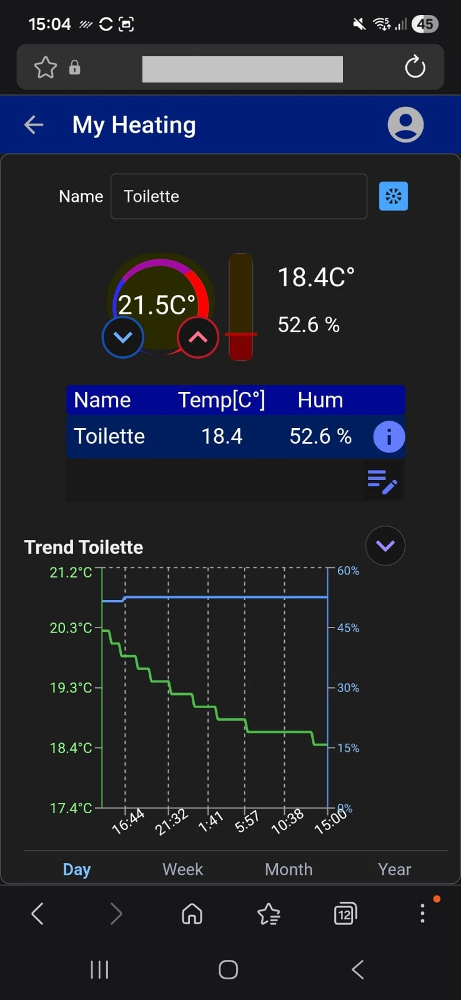

# NextJSHeating-Community
NextJS heating solution with mqtt, Zigbee2mqtt, mariadb, caddy, docker, raspberry 

A modern web application for monitoring and managing heating systems, built with Next.js, mqtt, Zigbee2mqtt, mariadb, caddy, docker, raspberry.

## Features

- Modern responsive web interface
- Almost Real-time heating data visualization
- Configuration management
- REST API backend integration
- User authentication and authorization
- Mobile-friendly design
- utilising raspberry pi 5 as server and controller of the heating strangs

## Mobile browser View



## Technology Stack

- 
- React
- TypeScript
- Node.js
- Tailwind CSS
- REST APIs
- MQTT
- 
- JWT
- Mariadb
- Caddy
- Zigbee2mqtt

## Getting Started
on a frech installed Ubuntu 24 on a 
- Raspberry PI 5 (Ubuntu)
- Zigbee adapter (SONOFF Zigbee 3.0 USB Dongle Plus | ZBDongle-E × 1) 
- SONOFF SNZB-02D Zigbee Temperature and Humidity Sensor,

### Prerequisites

- Node.js 20+
- npm or yarn
- Git
- Docker

### Installation

install ssh on ubuntu
```bash
sudo apt update
sudo apt install openssh-server -y
sudo systemctl enable ssh
sudo ufw allow 22/tcp
```

install Docker
```bash
// get curl to download something
sudo apt install curl
// get docker
curl -fsSL https://get.docker.com -o get-docker.sh
// execute install script
sudo sh get-docker.sh
// give docker root priviledges 
sudo usermod -aG docker $USER
// just update
sudo apt update
sudo apt upgrade
```
install vs code for convinience
```bash
sudo apt update
sudo apt install wget gpg -y

wget -qO- https://packages.microsoft.com/keys/microsoft.asc \
| gpg --dearmor > packages.microsoft.gpg

sudo install -D -o root -g root -m 644 packages.microsoft.gpg \
/etc/apt/keyrings/packages.microsoft.gpg

echo "deb [arch=$(dpkg --print-architecture) signed-by=/etc/apt/keyrings/packages.microsoft.gpg] https://packages.microsoft.com/repos/code stable main" \
| sudo tee /etc/apt/sources.list.d/vscode.list > /dev/null

rm -f packages.microsoft.gpg

sudo apt update
sudo apt install code -y
```

Clone the repository:
```bash
sudo apt install git
git clone https://github.com/logmytop-collab/NextJSHeating-Community.git
cd NextJSHeating-Community
```
Create environment files
- server
```sh
nano ./server_api/.env
```
```bash
PORT=5000

MOSQUITTO_USER=markus
MOSQUITTO_PWD=markus

DB_HOST=mariadb
DB_PORT=3306
DB_PWD=Crazy007

NODE_ENV=production
JWT_SECRET=your-super-secret-jwt-key-change-this-in-production
JWT_REFRESH_SECRET=your-super-secret-refresh-key-change-this
MOSQUITTO_SERVER=mosquitto
```
- frontend
```sh
nano ./frontendjs/.env
```
```bash
JWT_SECRET=your-super-secret-jwt-key-change-this-in-production
JWT_REFRESH_SECRET=your-super-secret-refresh-key-change-this

ACCESS_TOKEN_EXPIRY=15m
REFRESH_TOKEN_EXPIRY=7d

NODE_ENV=development
```
Configuration of Dongle
connect the DOngle and run 
```bash
->ls /dev/serial/by-id
```
you should see something like 
```shell
lrwxrwxrwx 1 root root 13 Nov 12 08:50 usb-Itead_Sonoff_Zigbee_3.0_USB_Dongle_Plus_V2_921e55bdcec2ef11a32d4cac8048b910-if00-port0 -> ../../ttyUSB0
```
add the device to devices in the docker-compose.yaml file 
```yaml
 zigbee2mqtt:
   devices:
      # Make sure this matched your adapter location
      - /dev/serial/by-id/usb-Itead_Sonoff_Zigbee_3.0_USB_Dongle_Plus_V2_3680e523ea73ef11acb6db1e313510fd-if00-port0:/dev/ttyUSB0
      # - /dev/serial/by-id/usb-Itead_Sonoff_Zigbee_3.0_USB_Dongle_Plus_V2_921e55bdcec2ef11a32d4cac8048b910-if00-port0:/dev/ttyUSB0  
```

Build docker container and run

```bash
docker compose up --build
```

Open your browser:

```
[http://localhost:3000/login](http://localhost:3000/login)
```
login with admin, pwd: 4711

## Configuration

The configuration and the connecting of new device happen over Zigbee2mqtt please also look at [Zigbee2mqtt](https://www.zigbee2mqtt.io/guide/usage/integrations/home_assistant.html)

```
http://localhost:8080/
```
## Project Structure

```text
./
├── caddy/
├── frontendjs/
├── mariadb_conf/
├── mqtt/
├── server_api/
└── zigbee2mqtt/
docker-compose.myl
```
## Support the Project

If you find this project useful, please consider:

- Starring the repository
- Reporting bugs and suggesting improvements
- Contributing code or documentation
- Supporting ongoing development with a donation

☕ Buy me a coffee:[ https://buymeacoffee.com/logmytop](https://buymeacoffee.com/logmytop8)

## Issues

If you find a bug or have a feature request, please open an Issue in GitHub.

## 

This project is licensed under the MIT License. See the LICENSE file for details.

## Disclaimer

This software is provided "as is" without warranty of any kind. Use at your own risk.
